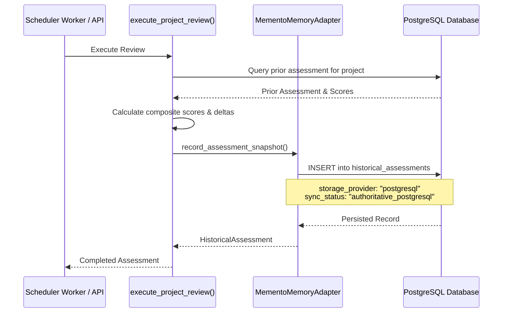

# Memento AI Memory & Architecture Integration Guide (v1.0.5)

## 1. Product Identity & Architecture Verification

Following an independent architectural review of official Memento documentation:
- **Official Website**: [https://runmemento.com/](https://runmemento.com/)
- **Official Repository**: [https://github.com/veerps57/memento](https://github.com/veerps57/memento)

### Core Product Architecture
Memento is designed as an open-source, **local-first Model Context Protocol (MCP)** server for developer IDE environments (such as Claude Code, Cursor, and Windsurf).

- **Transport**: Standard Input/Output (`stdio`) JSON-RPC MCP protocol (launched via `npx -y @psraghuveer/memento`).
- **Storage Layer**: Embedded SQLite database located at `~/.local/share/memento/memento.db`.
- **Supported MCP Tools**:
  1. `create_memory`: Persists architectural and conversational context with tags and metadata.
  2. `retrieve_memory`: Fetches a specific memory record by ID.
  3. `search_memories`: Executes semantic and keyword queries across stored memory notes.
  4. `list_memories`: Returns paginated lists of historical memory items.

---

## 2. Technical Evaluation for Multi-Tenant Enterprise Backends

An evaluation of operating an MCP stdio client directly from a Python backend in a multi-tenant cloud SaaS revealed three critical constraints:

1. **Tenant Isolation Boundaries**:
   Official Memento writes to a single shared SQLite database (`~/.local/share/memento/memento.db`) on the host/container filesystem. In a multi-tenant platform like TechDebt AI, co-mingling multiple organizations' architecture assessments into a single local SQLite file violates data isolation.
2. **Concurrency & File Locking**:
   SQLite supports single-writer concurrency. Multiple distributed worker processes executing assessments simultaneously encounter file lock contention (`database is locked`).
3. **Absence of Official Hosted Cloud REST API**:
   `runmemento.com` does not provide an official multi-tenant cloud REST API. The previously assumed endpoint (`api.memento.ai/v1`) is an unverified external dependency.

### Architectural Decision & v1.0.5 Configuration Cleanup
- **Disabled Unsupported Cloud REST Calls**: To prevent ungrounded network requests and false connectivity claims, external REST calls to unverified cloud endpoints are completely disabled.
- **Removed Obsolete Configuration Variables**: In v1.0.5, obsolete `MEMENTO_API_KEY` and `MEMENTO_API_URL` settings were cleanly removed from `.env.example`, `docker-compose.yml`, backend configuration models, and database schema.
- **PostgreSQL as Authoritative Storage**: TechDebt AI retains **PostgreSQL** as the authoritative historical assessment and memory store (`HistoricalAssessment` model).
- **Truthful Provenance Reporting**: The system transparently reports `storage_provider: "postgresql"` and `sync_status: "authoritative_postgresql"` across all API endpoints and frontend views.

---

## 3. Authoritative PostgreSQL Memory Schema

Historical assessment snapshots are persisted in the `historical_assessments` PostgreSQL table with full relational integrity and organization-level scoping:

| Column | Type | Description |
| :--- | :--- | :--- |
| `id` | UUID (PK) | Unique snapshot identifier |
| `project_id` | UUID (FK) | Scoped project foreign key (enforcing tenant isolation) |
| `assessment_id` | UUID (FK) | Associated assessment run |
| `health_score` | Float | Composite 8-dimension health score (0–100) |
| `score_delta` | Float | Arithmetic drift compared to immediate prior assessment |
| `risk_classification` | Enum | Healthy, Good, Moderate Risk, High Risk, Critical Debt |
| `snapshot_data` | JSONB | Complete technology scores, evidence sources, and risks |
| `summary_of_changes` | Text | Human-readable explanation of score improvements or regressions |
| `new_risks_count` | Integer | Count of newly emerged risks in this assessment run |
| `resolved_risks_count`| Integer | Count of previously identified risks successfully resolved |
| `storage_provider` | String | Truthful source (`postgresql`) |
| `sync_status` | String | Verification status (`authoritative_postgresql`) |

---

## 4. Truthful Provenance Flow

---

## 5. Frontend Transparency & Status Display

In the user interface, TechDebt AI truthfully reports memory status:

- **Integrations View (`/settings`)**:
  - Provider: `Memento Historical Memory`
  - Category: `Historical Context & Memory`
  - Status: `PostgreSQL Authoritative Active` (Badge: emerald)
  - Description: Notes that PostgreSQL is the authoritative multi-tenant store, while official Memento is an MCP tool for developer IDEs.
  - Link: Directs to official documentation at `https://runmemento.com`.
- **Historical Intelligence View (`/history`)**:
  - Active Memory Layer Badge: Displays `PostgreSQL Authoritative Memory`.
  - Never claims unverified `Memento Cloud Connected`.

---

## 6. Automated Verification Tests

The implementation is verified through automated test suites:
- `test_memento_mcp_architecture_verification`: Verifies `verify_connectivity()` truthfully reports `postgresql_authoritative` and references `runmemento.com`.
- `test_memento_authoritative_postgresql_memory_creation`: Verifies snapshot persistence in PostgreSQL with delta calculation and risk counts.
- `test_memento_authoritative_postgresql_memory_retrieval`: Verifies retrieval of historical snapshots from PostgreSQL.
- `test_memento_delta_comparison_with_postgresql_provenance`: Verifies longitudinal delta comparisons.
- `test_memento_live_api_connectivity_and_operations`: Clearly marked live integration test (`@pytest.mark.skipif(not os.getenv("MEMENTO_API_KEY"))`).
